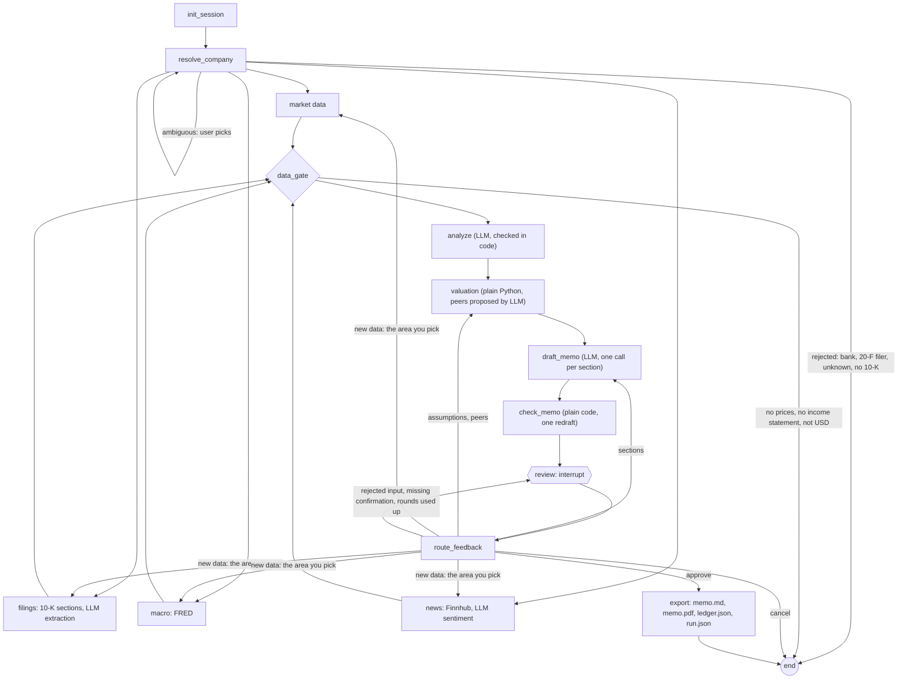
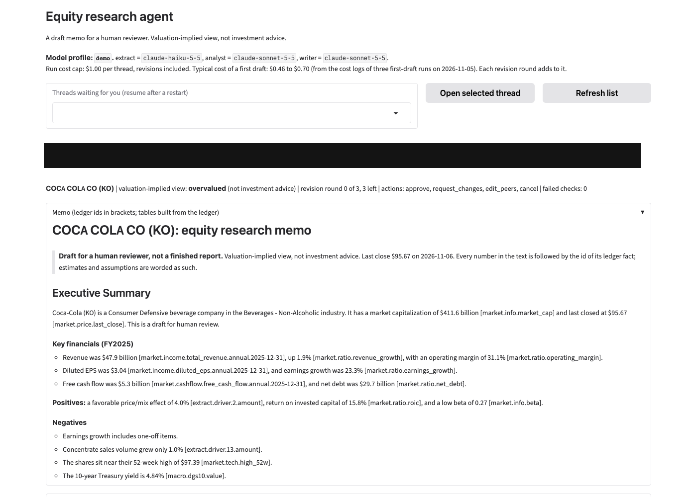

# Equity Research Agent

Type the name or ticker of a US-listed company and the agent drafts a ten-section equity research memo: overview, industry, historical financials, thesis, outlook, valuation, risks, conclusion, and a methodology section that lists every source. A person reviews the draft in a web app, asks for changes, and approves it. Only then are `memo.md`, `memo.pdf`, `ledger.json` and `run.json` written.

This is a portfolio project about the engineering around a language model: a LangGraph graph with checkpoints and a human review step, model output that is checked in code before it is used, a ledger that traces every number to its source, a cost cap, and tracing.

The memo is a draft for a human reviewer. It gives a valuation-implied view, not investment advice.

## Architecture



Four collectors run in parallel and write facts to a ledger: market data from yfinance, reported figures from SEC XBRL, Items 1, 1A and 7 of the 10-K read with edgartools, macro series from FRED, and recent news from Finnhub. A gate stops the run when prices or the income statement are missing and records everything else it could not get as a data gap.

Language models do a few jobs: extract facts from the 10-K, score each news article, write the analysis, propose peers for the comparables, and write the memo, one call per section. Everything else is plain Python: company resolution, ratios, the DCF and comparables, the rating rule, the memo checks, feedback routing and export. Nodes ask for a role (`extract`, `analyst` or `writer`) and `equity_agent/models.yaml` maps roles to model IDs. The default profile uses Claude Haiku 5.5 for extraction and sentiment and Claude Sonnet 5.5 for the analysis, the peers and the memo text.

No model output is used unchecked. An extracted item has to quote the filing word for word, with every number inside the quote. A sentiment score has to quote its article. An analysis finding has to cite ledger ids whose values match the numbers in its sentence. An item that fails is retried once, then dropped and logged. In the memo, every number carries a ledger id. `check_memo` tests that the id exists, that the number matches the fact under a written rounding rule (`equity_agent/numbers.py`), that estimates are worded as estimates, and that known data gaps are mentioned. A section that still fails after one redraft is marked `FAILED CHECKS` and listed in the methodology section.

Facts have a kind: `reported`, `derived`, `summary`, `assumption` or `model_estimate`. A missing input becomes a data gap and never a placeholder number.

The review step is a LangGraph interrupt. The reviewer can approve, redraft chosen sections with an instruction, change four valuation assumptions, edit the peer list, or ask for new data, for at most three rounds. Sections that were not chosen stay byte-identical. State lives in SQLite checkpoints, so a restarted app picks up a waiting thread. Every run gets a cost log, and a LangSmith link when tracing is switched on (see below), and a thread stops before its next model call once its logged cost reaches the cap (`max_run_cost_usd`, 1.00 USD on the default profile).

The code is in `equity_agent/`. `graph.py` wires the nodes in `nodes/`, and `app.py` is the only module that imports Gradio.

## Example: a Coca-Cola memo

Typing "Coca-Cola" into the app lists two matches, Coca-Cola Co (KO, NYSE) and Coca-Cola Consolidated (COKE, Nasdaq), and you pick one. The draft below is a KO run from 2026-11-07 on the default profile: 48 model calls, 266 seconds, $0.52. `check_memo` redrafted two sections (Historical Financial Analysis and Valuation) and none failed its checks. The run had two data gaps, both listed in the methodology section.

This is the valuation paragraph of the Executive Summary as the model wrote it. The exported `memo.md` turns each id into a numbered reference linked to a table of sources.

> **Valuation-implied view:** overvalued, based on the DCF scenarios. We estimate $30.41 [valuation.dcf.bear.value_per_share] per share in the bear case, $42.99 [valuation.dcf.base.value_per_share] in the base case and $58.26 [valuation.dcf.bull.value_per_share] in the bull case. Only the peer P/E cross-check, at an implied $105.08 [valuation.comps.implied.pe], lies above the last close. The result depends heavily on assumptions. It is a valuation-implied view, not investment advice.

The last close in that memo was $95.67 [market.price.last_close]. All three DCF values sit far below it, and the discount rate drives much of the gap: KO's beta is 0.27 [market.info.beta], which gives a WACC of 5.9% [valuation.input.wacc]. The reviewer decides what weight that deserves. In a test run, asking for a shorter Company Overview rewrote that section and the Executive Summary and left every other section unchanged. Approving writes the four files to `outputs/KO_<date>/`.

## The app



The top of the review page shows the model profile with its cost cap and typical cost, a list of threads waiting for review (so a restarted app resumes where it stopped), a summary line with the rating, the revision round, the available actions and the number of failed checks, and the memo with its ledger ids. Below the memo, outside this image, the page has the data gaps and coverage, the failed checks, the peers used and the decision buttons. The thread id and trace link, which sit between the list and the summary line, are covered by the black bar.

## Run it yourself

You need Python 3.12 and four credentials. The Anthropic API is billed per token.

| Variable | What it is |
|---|---|
| `ANTHROPIC_API_KEY` | Anthropic API key |
| `FRED_API_KEY` | key from the FRED website |
| `FINNHUB_API_KEY` | Finnhub key, used under Finnhub's terms |
| `EDGAR_USER_AGENT` | your name and email, which the SEC requires on every request |

`LANGSMITH_API_KEY` and `LANGSMITH_TRACING` are optional and switch on the trace links.

```bash
git clone https://github.com/DamianoGiuseppetti/Equity_Research_Agent.git
cd Equity_Research_Agent
python3.12 -m venv .venv
source .venv/bin/activate
pip install -r requirements.txt
pip install -e .
cp .env.example .env        # then fill in the keys above
python -m equity_agent app  # http://127.0.0.1:7860
```

WeasyPrint needs the Pango library for the PDF (macOS: `brew install pango`; see the WeasyPrint documentation for other systems). Without it, `memo.md`, `ledger.json` and `run.json` are still written and the app names the missing file.

Other commands: `python -m equity_agent run KO` runs the same graph from the command line, `threads` lists stored runs, and `resume <thread_id>` continues a stopped one. Set `EQUITY_AGENT_PROFILE=dev` to run every role on Haiku while you test. State is written to `.data/`, raw pulls to `.cache/` and exports to `outputs/<TICKER>_<date>/`; all three are git-ignored.

## Costs

List prices per million tokens: Haiku 5.5 $0.10 in and $0.50 out, Sonnet 5.5 $2 in and $10 out. Five first drafts on the default profile cost between $0.46 and $0.70 each (KO $0.46 and $0.52, XOM $0.63, AAPL $0.70 and $0.54), taking four to five minutes. The same graph on the Haiku-only profile cost $0.04 to $0.05 in the runs measured.

A revision adds to the thread's total. From the per-call costs in the KO log, a section redraft should cost roughly $0.05 to $0.15 and an assumptions edit $0.18 to $0.35; these are estimates, not measured. Sonnet 5.5 cannot switch thinking off, so its writer calls include thinking tokens. SEC EDGAR, FRED and yfinance cost nothing.

## Known limitations

- The checks prove that numbers match the ledger and that quotes are exact. They do not fact-check statements. A sentence can cite correct numbers and still be wrong or unwise, so a person has to read the memo.
- The valuation uses fixed, simple rules and can differ sharply from the market. It is sensitive to beta: for low-beta companies such as Coca-Cola the WACC is low and the DCF lands far below the price, while peer multiples can land above it. The memo shows both.
- The model writes the memo, so quality varies between runs. A section can fail its checks, and one that still fails after the redraft is shown with its problems. Five first drafts on the default profile passed all checks, which is a sample of five and not a rate.
- Extracted summaries, the risk ranking, sentiment scores and the peer choice are model output and are labelled as summaries or estimates. What the model left out of an extraction is not measured.
- Scope is US companies that file a 10-K and report in USD. Banks and insurers are rejected because a DCF does not fit them, and a recent IPO without a 10-K is rejected. Only the 10-K is read, not the latest 10-Q.
- News text is fetched for part of the articles, and blocked pages and paywalls are dropped and counted. With fewer than five scored articles no sentiment average is shown.
- The PDF export was tested on macOS only; WeasyPrint on Linux is untested.
- LangSmith trace links expire after 14 days on the free plan.

## Data sources and licence

Filings and XBRL facts come from SEC EDGAR, prices and statements from Yahoo Finance through `yfinance`, macro series from FRED, and the news list from Finnhub. Finnhub's terms allow personal use and bar redistributing its data, so the app never exports article text: a memo cites a news article by headline, source, date and URL. Check each provider's terms before you use the data beyond personal research.

The code is released under the MIT licence (see `LICENSE`).

## Disclaimer

This project is for research and education. Nothing it produces is investment advice. The memo is a draft that needs a human reviewer, and the author accepts no responsibility for decisions taken on it.
